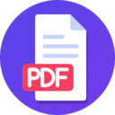

<p align="center"></p>

# MyPDF

App Android em Kotlin que transforma fotos de folhas em um PDF A4. Ele desentorta a perspectiva, corrige a iluminação e junta várias páginas na ordem que você escolher. Depois você compartilha pelo WhatsApp ou por qualquer outro app.

Tudo roda no celular, **sem internet**. O app nem pede a permissão `INTERNET`.

[](https://github.com/AndreFilho0/MyPDF/actions/workflows/ci.yml)
[](https://github.com/AndreFilho0/MyPDF/releases/latest)

## Baixar e instalar (sem precisar de computador)

1. No celular Android (8.0 ou superior), abra a página da **[última versão](https://github.com/AndreFilho0/MyPDF/releases/latest)**.
2. Em *Assets*, baixe o arquivo `MyPDF-vX.Y.Z.apk`.
3. Abra o arquivo baixado. Se o Android pedir, permita **"Instalar apps desconhecidos"** para o navegador ou o gerenciador de arquivos, e toque em **Instalar**.

Para atualizar, baixe a versão nova e instale por cima: os PDFs gerados são mantidos.

O APK é gerado para celulares de 64 bits (`arm64-v8a`), que são praticamente todos os lançados de 2017 para cá.

Se você quer compilar o código ou mexer no projeto, veja [Instalação pelo código-fonte](#instalação-pelo-código-fonte).

## O que ele faz

- Tira várias fotos seguidas sem sair da câmera, e mostra o contorno da folha ao vivo
- Importa várias imagens da galeria de uma vez, sem pedir permissão de armazenamento
- Detecta sozinho os 4 cantos da folha
- Deixa ajustar os cantos com o dedo, com uma lupa para dar precisão
- Tem dois modos de imagem por página:
  - **Natural**: mantém as cores e só clareia as sombras
  - **Scanner**: fundo branco e tinta escura
- Reordena as páginas arrastando, e também gira e exclui páginas
- Gera um PDF A4 em qualidade Normal (150 dpi) ou Alta (200 dpi). No Normal, cada página costuma ficar bem abaixo de 400 KB
- Mostra uma prévia do PDF, com zoom, antes de enviar
- Compartilha (WhatsApp, Drive, e-mail...), salva em Downloads ou abre em outro app
- Guarda um histórico dos PDFs gerados

## Como usar o app

1. Na tela inicial, toque em **Câmera** ou **Galeria**.
2. **Câmera**: aponte para a folha. O contorno azul mostra o que foi detectado. Tire quantas fotos quiser e toque em **Concluir**.
3. **Ajustar cantos**: confira cada página.
   - Arraste um canto se a detecção errou.
   - **Resetar** volta ao que foi detectado, e **Inteira** usa a foto toda.
   - **Confirmar** passa para a próxima página. **Aceitar todas** pula a revisão das que faltam.
4. **Páginas**:
   - Segure uma miniatura e arraste para mudar a ordem.
   - No menu ⋮ de cada página dá para girar, trocar entre Natural e Scanner, reajustar os cantos ou excluir.
   - **Adicionar** traz mais folhas.
5. **Gerar PDF**: escolha o nome e a qualidade. A prévia abre sozinha. Dela você compartilha, salva em Downloads ou toca em **Concluir** para começar outro documento.

Os PDFs ficam na lista da tela inicial. Toque em um para ver a prévia de novo.

## Instalação pelo código-fonte

Este caminho é para quem quer compilar o app. Ele é compilado no computador e instalado no celular pelo cabo USB. Na primeira vez são quatro passos; depois, para atualizar, é só o último.

### 1. Preparar o computador

Ferramentas necessárias:

| Ferramenta | Versão | Para quê |
| --- | --- | --- |
| **Git** | qualquer | Baixar o projeto |
| **JDK** (Java) | 17 ou 21 | Rodar o Gradle e compilar o Kotlin |
| **Android SDK Platform** | 36 | Compilar o app |
| **Android SDK Build-Tools** | 35 ou mais nova | Empacotar o APK |
| **Android SDK Platform-Tools** (`adb`) | mais recente | Conversar com o celular pelo cabo |
| ~~Gradle~~ | não precisa instalar | O `./gradlew` do projeto baixa a versão certa (8.14.3) sozinho |
| ~~Kotlin, OpenCV, bibliotecas~~ | não precisa instalar | O Gradle baixa tudo na primeira compilação |

Também é preciso:
- uns **4 GB livres** em disco, entre o Android SDK e o cache do Gradle;
- **internet na primeira compilação**, para baixar as bibliotecas. Depois disso elas ficam dentro do APK, e o app nunca usa internet.

Há dois jeitos de instalar essas ferramentas.

#### Opção A: Android Studio (mais fácil, qualquer sistema)

1. Baixe e instale o [Android Studio](https://developer.android.com/studio). Ele já vem com o JDK, o SDK e o `adb`.
2. Na primeira abertura, siga o assistente com a instalação padrão ("Standard").
3. Abra a pasta do projeto (**File → Open**) e espere o Gradle sincronizar. Se ele pedir para instalar o "Android SDK Platform 36", aceite.

Daí para instalar no celular basta escolher o aparelho na barra de cima e clicar em **Run ▶**, depois de fazer o passo 3 (depuração USB).

#### Opção B: só linha de comando

**Linux**

```bash
# Arch / Manjaro
sudo pacman -S jdk21-openjdk git android-udev
# Ubuntu / Debian
sudo apt install openjdk-21-jdk git android-sdk-platform-tools-common
```

O pacote `android-udev` / `android-sdk-platform-tools-common` traz as regras que deixam o `adb` acessar o celular sem `sudo`.

Depois baixe as **"Command line tools only"** no fim da página do [Android Studio](https://developer.android.com/studio#command-line-tools-only) e instale o SDK:

```bash
mkdir -p ~/Android/Sdk/cmdline-tools
unzip commandlinetools-linux-*.zip -d ~/Android/Sdk/cmdline-tools
mv ~/Android/Sdk/cmdline-tools/cmdline-tools ~/Android/Sdk/cmdline-tools/latest

# coloque estas duas linhas também no ~/.bashrc (ou ~/.zshrc)
export ANDROID_HOME=$HOME/Android/Sdk
export PATH=$PATH:$ANDROID_HOME/cmdline-tools/latest/bin:$ANDROID_HOME/platform-tools

sdkmanager "platform-tools" "platforms;android-36" "build-tools;35.0.0"
sdkmanager --licenses   # aceite com "y"
```

**macOS** (com [Homebrew](https://brew.sh))

```bash
brew install openjdk@21 git
brew install --cask android-commandlinetools android-platform-tools
export ANDROID_HOME=/opt/homebrew/share/android-commandlinetools
sdkmanager "platforms;android-36" "build-tools;35.0.0"
sdkmanager --licenses
```

**Windows**: o caminho mais simples é a Opção A (Android Studio). Ainda é preciso:
- instalar o Git (`winget install Git.Git`);
- para celulares Samsung, instalar o [driver USB da Samsung](https://developer.samsung.com/android-usb-driver), senão o `adb` não enxerga o aparelho;
- nos comandos abaixo, usar `gradlew.bat` no lugar de `./gradlew`.

Para conferir se ficou tudo certo:

```bash
java -version      # 17 ou 21
adb version
```

### 2. Baixar o projeto

```bash
git clone https://github.com/AndreFilho0/MyPDF.git
cd MyPDF
```

O Gradle precisa saber onde está o Android SDK. O Android Studio resolve isso sozinho, e na linha de comando a variável `ANDROID_HOME` do passo anterior já basta. Se der o erro "SDK location not found", crie o arquivo `local.properties` na raiz do projeto:

```properties
# Linux
sdk.dir=/home/SEU_USUARIO/Android/Sdk
# macOS: sdk.dir=/Users/SEU_USUARIO/Library/Android/sdk
# Windows: sdk.dir=C\:\\Users\\SEU_USUARIO\\AppData\\Local\\Android\\Sdk
```

### 3. Liberar a depuração USB no celular (só na primeira vez)

O celular precisa ter **Android 8.0 ou superior**.

1. **Configurações → Sobre o telefone → Informações de software** (no Samsung). Em outras marcas costuma ser só "Sobre o telefone".
2. Toque **7 vezes** em **"Número de compilação"** até aparecer "Modo de desenvolvedor ativado".
3. Volte às Configurações e entre em **Opções do desenvolvedor** (fica no fim da lista).
4. Ative **Depuração USB**. Em celulares Xiaomi, ative também **"Instalar via USB"**.
5. Ligue o cabo. No celular, toque em **Permitir** na pergunta "Permitir depuração USB?" e marque "Sempre permitir deste computador".

Para conferir se o computador está vendo o celular:

```bash
adb devices
# deve listar o aparelho com a palavra "device"
```

Se aparecer `unauthorized`, desbloqueie o celular e aceite a pergunta. Se não aparecer nada, puxe a barra de notificações e mude o modo USB para **Transferência de arquivos**.

### 4. Compilar e instalar

Na pasta do projeto:

```bash
./gradlew installDebug
```

A primeira vez demora alguns minutos, porque o Gradle baixa as bibliotecas. Depois ficam uns 30 segundos.

Pronto, o **MyPDF** aparece na lista de apps. Pode tirar o cabo: o app funciona normalmente sem o computador. Quando não estiver usando, vale desligar a Depuração USB.

Para **atualizar** depois de mudar o código, ligue o cabo e rode o mesmo comando. O histórico de PDFs é mantido.

Se preferir instalar o APK manualmente:

```bash
./gradlew assembleDebug
adb install -r app/build/outputs/apk/debug/app-debug.apk
```

Também dá para copiar esse `.apk` para o celular e abrir pelo gerenciador de arquivos. Nesse caso o Android pede para permitir "instalar apps desconhecidos".

### Problemas comuns

| Erro | Solução |
| --- | --- |
| `SDK location not found` | Defina `ANDROID_HOME` ou crie o `local.properties` (passo 2) |
| `Unsupported class file major version` ou erro de versão do Java | Use o JDK 17 ou 21 (`java -version`). Com vários instalados, aponte o `JAVA_HOME` para um deles |
| `Failed to install the following SDK components` / licenças | Rode `sdkmanager --licenses` e aceite |
| `adb devices` vazio no Linux | Instale as regras udev (passo 1) e reconecte o cabo |
| `INSTALL_FAILED_UPDATE_INCOMPATIBLE` | O app foi instalado de outro computador (outra assinatura). Desinstale o MyPDF do celular e instale de novo |

### Emulador e outras arquiteturas

Para deixar o APK menor, ele é gerado só para `arm64-v8a`, que é a arquitetura de praticamente todos os celulares atuais. O OpenCV pesa uns 20 MB por arquitetura. Para rodar num emulador x86_64:

```bash
./gradlew installDebug -Pabis=x86_64
# ou várias: -Pabis=arm64-v8a,x86_64
```

## Publicar uma nova versão (CI/CD)

O projeto tem dois pipelines no GitHub Actions (`.github/workflows/`):

| Pipeline | Quando roda | O que faz |
| --- | --- | --- |
| **CI** (`ci.yml`) | Push ou pull request na `main` | Roda os testes de unidade e compila os APKs de debug e release. O de debug fica disponível por 7 dias na aba Actions |
| **Release** (`release.yml`) | Push de uma tag `vX.Y.Z` | Roda os testes, gera o APK assinado e publica uma Release com o `MyPDF-vX.Y.Z.apk` para download |

### Configuração (só na primeira vez)

O APK da Release é assinado sempre com a mesma chave. É isso que permite instalar uma versão nova por cima da antiga. A chave fica com você, e o GitHub recebe uma cópia como secret.

**1. Criar a chave**, fora da pasta do projeto:

```bash
mkdir -p ~/.android-keys
keytool -genkeypair -v -keystore ~/.android-keys/mypdf-release.jks \
  -alias mypdf -keyalg RSA -keysize 4096 -validity 10000
```

O `keytool` vem junto com o JDK. Ele pede uma senha e alguns dados; os dados podem ser só o seu nome.

> **Guarde uma cópia desse arquivo `.jks` e da senha** num lugar seguro, como um gerenciador de senhas. Se perder, as próximas versões não vão instalar por cima das antigas: quem tiver o app vai precisar desinstalar e perder o histórico.

**2. Cadastrar os secrets** em **GitHub → repositório → Settings → Secrets and variables → Actions → New repository secret**:

| Secret | Valor |
| --- | --- |
| `MYPDF_KEYSTORE_BASE64` | Saída de `base64 -w0 ~/.android-keys/mypdf-release.jks` (no macOS: `base64 -i ~/.android-keys/mypdf-release.jks`) |
| `MYPDF_KEYSTORE_PASSWORD` | A senha escolhida no `keytool` |
| `MYPDF_KEY_ALIAS` | `mypdf` |
| `MYPDF_KEY_PASSWORD` | A mesma senha |

### Lançar uma versão

```bash
git tag v1.0.0
git push origin v1.0.0
```

Em uns 5 minutos a Release aparece em **Releases**, com o APK, o arquivo `.sha256` e as notas geradas a partir dos commits. O número da versão vem da tag: `v1.2.3` vira a versão `1.2.3` do app.

Para as próximas, é só aumentar o número (`v1.0.1`, `v1.1.0`...). Uma tag fora do formato `vX.Y.Z` faz o pipeline falhar com uma mensagem explicando.

### Gerar o APK assinado no computador

Para gerar localmente o mesmo APK que o pipeline publica:

```bash
export MYPDF_KEYSTORE=~/.android-keys/mypdf-release.jks
export MYPDF_KEYSTORE_PASSWORD='sua senha'
export MYPDF_KEY_ALIAS=mypdf
export MYPDF_KEY_PASSWORD='sua senha'
./gradlew assembleRelease -PversionName=1.0.0 -PversionCode=10000
# APK em app/build/outputs/apk/release/app-release.apk
```

Sem essas variáveis, o `assembleRelease` assina com a chave de debug. Serve para testar, mas não para distribuir.

## Testes

```bash
# Testes de unidade (JVM): geometria dos cantos e o gerador de PDF
./gradlew testDebugUnitTest

# Testes no aparelho/emulador: o processamento inteiro com OpenCV
# (detecção, perspectiva, modos Natural/Scanner, PDF válido e tamanho)
./gradlew connectedDebugAndroidTest
```

## Como funciona

### Processamento de cada página

1. **Carregar**: aplica a rotação EXIF e limita o lado maior a 3000 px.
2. **Detectar a folha**, numa cópia de 1000 px:
   - Usa duas máscaras: bordas (Canny) e papel claro (HSV com pouca saturação e muito brilho).
   - Pega o maior contorno, tira o envoltório convexo e simplifica com `approxPolyDP` até sobrarem 4 cantos.
   - Se não encontrar, os cantos começam nas bordas da foto e o app mostra um aviso.
3. **Corrigir a perspectiva**: `warpPerspective` para 1654 × 2339 px, que é A4 a 200 dpi. Se a folha estava deitada na foto, a saída também fica deitada; aí é só girar a página.
4. **Corrigir a iluminação**: estima o fundo do papel (fechamento morfológico + blur, calculado em 1/4 da resolução) e divide a imagem por ele.
   - **Natural** aplica metade desse ganho em cada canal de cor.
   - **Scanner** estica os níveis (150 → preto, 245 → branco) e aplica gama 1,6.
5. Salva a página como JPEG e gera uma miniatura de 300 px.

O processamento roda fora da thread principal, uma página por vez para não estourar a memória. Leva cerca de 1 s por foto de 12 MP.

### Decisões técnicas

| Escolha | Por quê |
| --- | --- |
| **OpenCV 4.10** embutido no APK | O ML Kit Document Scanner baixa módulos pelo Google Play Services na primeira vez, e o app precisa funcionar 100% offline |
| **Gerador de PDF próprio** (`JpegPdfWriter`) | O `PdfDocument` do Android grava as imagens sem compressão JPEG, com vários MB por página. O gerador próprio coloca o JPEG direto no arquivo e é Kotlin puro, sem biblioteca extra |
| **Jetpack Compose + Material 3** | Telas declarativas, com cores dinâmicas do sistema no Android 12+ |
| **CameraX** | Preview, foto em alta resolução e análise ao vivo |
| **Photo Picker** | Seleção múltipla da galeria sem pedir permissão |
| **FileProvider** + `ACTION_SEND` | Forma padrão de compartilhar arquivos no Android |
| Histórico em **JSON** (kotlinx.serialization) | Simples, sem banco de dados |

### Permissões

| Permissão | Para quê |
| --- | --- |
| `CAMERA` | Tirar as fotos |
| `WRITE_EXTERNAL_STORAGE` (só Android 8 e 9) | Salvar em Downloads. Do Android 10 em diante não precisa |
| ~~`INTERNET`~~ | **Não declarada**: o sistema garante que o app não acessa a rede |

As fotos e páginas temporárias ficam no armazenamento interno do app e são apagadas ao concluir ou descartar o documento.

## Estrutura do projeto

```
app/src/main/java/com/andre/scanner/
├── App.kt                      # inicializa o OpenCV
├── MainActivity.kt             # navegação entre as telas
├── model/Page.kt               # página: original, cantos, modo, rotação
├── viewmodel/DocumentViewModel.kt   # estado do documento e fila de processamento
├── processing/
│   ├── ImageLoader.kt          # EXIF, redimensionamento
│   ├── CornerDetector.kt       # detecção da folha
│   ├── PerspectiveCorrector.kt # desentortar para A4
│   ├── Enhancer.kt             # modos Natural e Scanner
│   ├── DocumentProcessor.kt    # junta as etapas
│   └── Geometry.kt             # ordenar cantos, convexidade (Kotlin puro)
├── pdf/
│   ├── JpegPdfWriter.kt        # gerador de PDF com JPEG embutido
│   └── PdfExporter.kt          # páginas → PDF A4
├── share/ShareHelper.kt        # compartilhar, abrir, salvar em Downloads
├── storage/                    # arquivos internos e histórico
└── ui/                         # telas em Compose
    ├── home/  camera/  crop/  pages/  export/  preview/
    └── common/  theme/
```

## Ideias para próximas versões

- Remover automaticamente o dedo e a espiral do caderno das bordas
- OCR para deixar o texto do PDF pesquisável
- Recortar várias folhas numa mesma foto

## Licença

Distribuído sob a licença MIT. Veja o arquivo [LICENSE](LICENSE).
